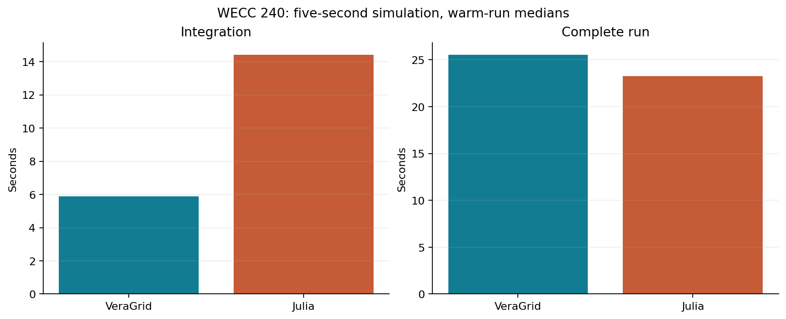

# WECC 240: five-second RMS benchmark

## Benchmark

This benchmark simulates the WECC 240-bus power system from `t = 0` to `t = 5 s`, with a line trip at `t = 1 s`. It compares VeraGrid's vectorized power-balance BDF integrator with PowerSimulationsDynamics.jl using Sundials IDA. Both engines record the dynamic response at `0.01 s` intervals. The comparison measures complete run time and integration time, then separates the measured RHS and Jacobian work. VeraGrid's sparse factorization and linear solve are measured separately; Julia does not expose an equivalent isolated timer here.

Each engine ran ten fresh simulations on the same host. Values below are median [10th, 90th percentile] over repetitions 2–10; the first cold run is retained in the CSVs. [Methods and reproduction](results/five_second_wecc/METHODS.md).

## What “vectorized” means here

VeraGrid sets `RmsProblemTypes.PowerBalanceVectorized`. It groups like dynamic components into array-based equation blocks, compiles their residual and sparse Jacobian, and assembles them with the network power-balance equations. The non-vectorized `PowerBalance` path instead builds and evaluates component equations individually. This benchmark times **the vectorized VeraGrid path only**; it contains no measured comparison against VeraGrid's non-vectorized path. Vectorization describes the equation assembly and evaluation, not a different physical grid or a shorter simulation.

Julia uses `ResidualModel` with Sundials IDA. The Julia results are a cross-engine comparison, not a measurement of Julia “non-vectorized” mode. Both engines model the same event, but their numerical implementations differ, so speed and trajectory error should be considered together.

## Results

| Measure | VeraGrid | Julia |
|---|---:|---:|
| Integration | 5.90 [5.83, 6.16] s | 14.43 [12.01, 18.22] s |
| Complete run | 25.56 [24.93, 25.94] s | 23.28 [20.28, 27.99] s |

VeraGrid integration is **2.45× faster**. Its complete run is slower because setup and simulation build take longer. VeraGrid trajectory RMSE against the committed Julia reference is **8.13e-05 p.u.**

| Integration phase | VeraGrid median | Julia median |
|---|---:|---:|
| RHS evaluation | 2.03 s | 0.64 s |
| Jacobian evaluation | 0.64 s | 4.06 s |
| Factorization and linear solve | 2.88 s | Not isolated |

Julia's remaining integration time includes linear solves and other solver work; it is not a separate linear-solve measurement. Raw measurements: [VeraGrid CSV](results/five_second_wecc/veragrid.csv) and [Julia CSV](results/five_second_wecc/julia.csv).

The [Numba compiled WECC follow-up](results/numba_comp_wecc/RESULTS.md) compares the fixed compiled RHS backend at 5 and 20 seconds, with a plot and phase timings. Its two warm runs per horizon are preliminary and separate from the ten-run baseline above.
