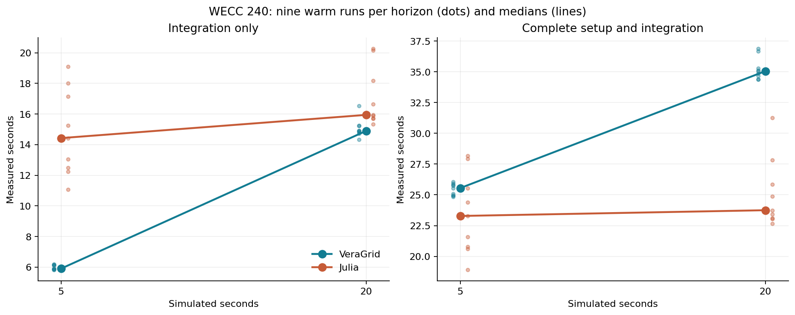
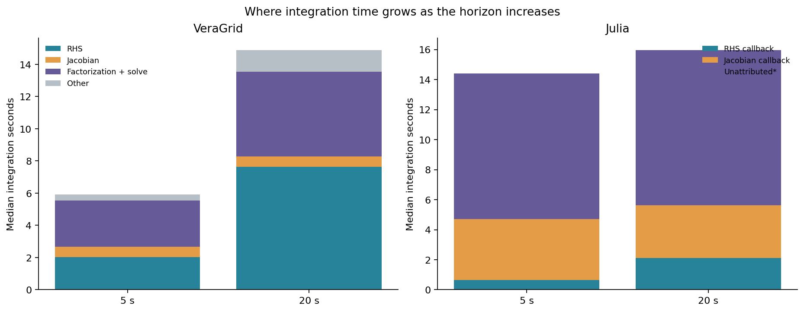

# WECC 240: five-second baseline and horizon study

The WECC 240 line trip occurs at `t = 1 s`. Each engine ran ten fresh simulations at each horizon. Tables show the median [10th, 90th percentile] over nine warm runs; the first run is retained in the raw data. See [methods](METHODS.md) for solver settings and reproduction.

| Horizon | VeraGrid integration (s) | Julia integration (s) | Julia / VeraGrid | VeraGrid total (s) | Julia total (s) | VeraGrid RMSE (p.u.) |
|---|---:|---:|---:|---:|---:|---:|
| 5 s | 5.90 [5.83, 6.16] | 14.43 [12.01, 18.22] | 2.45× | 25.56 [24.93, 25.94] | 23.28 [20.28, 27.99] | 8.13e-05 |
| 20 s | 14.89 [14.65, 15.51] | 15.94 [15.62, 20.18] | 1.07× | 35.06 [34.39, 36.71] | 23.75 [22.95, 28.51] | 0.000111 |

| Engine and phase | 5 s median | 20 s median | Added time |
|---|---:|---:|---:|
| VeraGrid RHS | 2.03 s | 7.63 s | +5.60 s |
| VeraGrid Jacobian | 0.64 s | 0.64 s | +0.01 s |
| VeraGrid factorization + solve | 2.88 s | 5.26 s | +2.38 s |
| VeraGrid other | 0.36 s | 1.35 s | +0.99 s |
| Julia RHS callback | 0.64 s | 2.11 s | +1.47 s |
| Julia Jacobian callback | 4.06 s | 3.52 s | -0.54 s |
| Julia unattributed* | 9.70 s | 10.34 s | +0.64 s |

VeraGrid accepted a median of 525 steps at five seconds and 2025 at twenty seconds. With the same maximum internal step, the extra 15 simulated seconds add approximately 1500 accepted steps. Its additional integration time is 9.00 s, versus 1.52 s for Julia. The measured phase growth indicates that VeraGrid's repeated RHS evaluations account for much of the narrowing advantage. This is an inference from phase times; the Julia linear-solver time is not isolated.

*Julia unattributed time includes linear solves, solver control, event handling, output, and timing overhead. It is not a linear-solver measurement. The implementations use different adaptive algorithms. The speed comparison must be read with trajectory error: VeraGrid RMSE is measured against the committed Julia reference over each horizon, using the same `1e-6` absolute and `1e-3` relative BDF tolerances at both horizons.*

Raw measurements: [`julia.csv`](julia.csv), [`veragrid.csv`](veragrid.csv). The [ten-run timing report](../ten_run_timing/RESULTS.md) includes the other cases.

## Numba compiled follow-up

The [Numba compiled WECC comparison](../numba_comp_wecc/RESULTS.md) shows preliminary 5- and 20-second runs of the fixed compiled RHS backend, including a timing plot and phase breakdown. It uses two warm compiled runs per horizon; the tables above retain the original nine-warm-run baseline.
