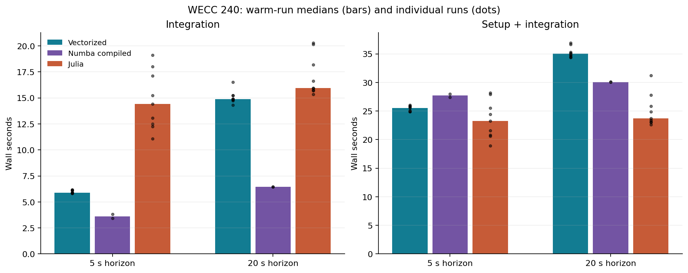

# WECC 240: Numba compiled RHS comparison

The full-vectorized Numba compiled backend was tested on the same line-trip case as the [five-second baseline](../five_second_wecc/RESULTS.md) and [twenty-second report](../ten_run_timing/RESULTS.md). The original VeraGrid and Julia baselines have nine warm runs each; the new Numba backend has **two warm runs** after one cold run at each horizon. These are preliminary timings, not a ten-run replacement for the baselines. [Methods and reproduction](METHODS.md).

| Horizon | Engine | Integration | RHS | Factorization + solve | Problem build | Complete run |
|---|---|---:|---:|---:|---:|---:|
| 5 s | Vectorized | 5.90 s | 2.03 s | 2.88 s | 17.96 s | 25.56 s |
| 5 s | Numba compiled | 3.62 s | 0.11 s | 3.10 s | 22.20 s | 27.71 s |
| 5 s | Julia | 14.43 s | 0.64 s | Not isolated | 8.43 s | 23.28 s |
| 20 s | Vectorized | 14.89 s | 7.63 s | 5.26 s | 18.35 s | 35.06 s |
| 20 s | Numba compiled | 6.46 s | 0.36 s | 4.79 s | 21.95 s | 30.08 s |
| 20 s | Julia | 15.94 s | 2.11 s | Not isolated | 7.60 s | 23.75 s |

At 20 seconds, the Numba compiled RHS takes **0.36 s** versus **7.63 s** for the original vectorized path. Its largest measured integration phase is sparse factorization and solve: **4.79 s**, about **74%** of integration. Problem build is the largest complete-run phase at **21.95 s**. Total time improves versus the original VeraGrid path at 20 seconds, but the longer build makes the 5-second complete run slower. Julia remains faster on complete-run time at both horizons.

The Numba backend and original vectorized path both accepted **525** steps at 5 seconds and **2,025** at 20 seconds, with no rejected steps. Their measured trajectory RMSE against the committed Julia reference agrees at **8.13e-05 p.u.** and **0.000111 p.u.** respectively.

Raw Numba measurements: [`five_second.csv`](five_second.csv) and [`twenty_second.csv`](twenty_second.csv). The original VeraGrid and Julia CSVs are linked from the baseline reports.
