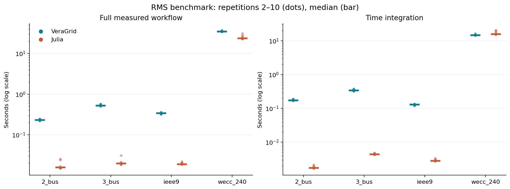
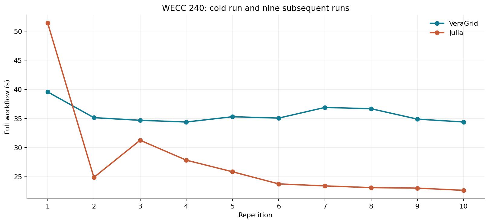
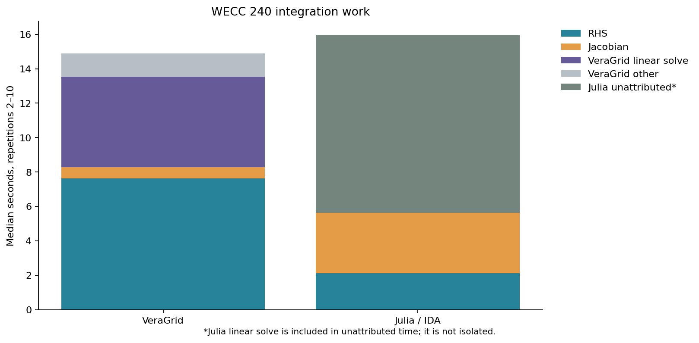
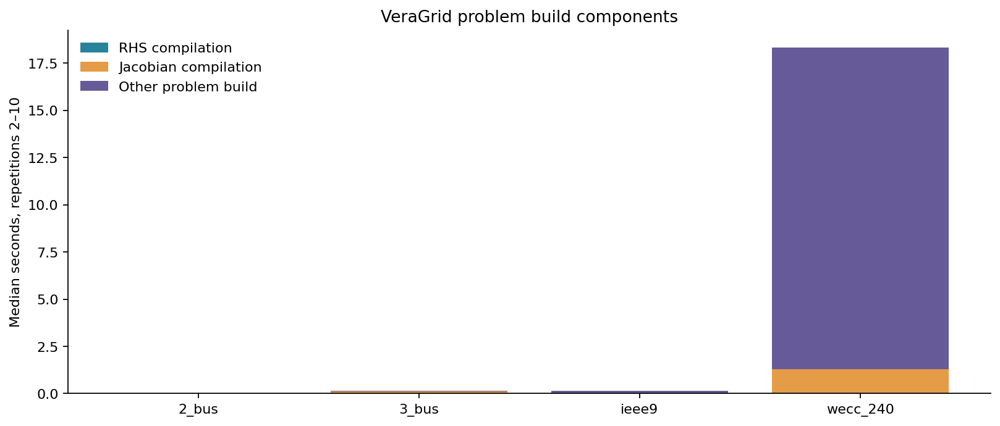

# PowerSimulationsDynamics.jl versus VeraGrid: ten-run RMS timing

Measured 2026-11-09 16:20 CET on `x86_64`; VeraGrid commit `465a963645`. Each engine ran ten fresh event simulations per case, sequentially on this host. The first repetition includes cold compilation and appears in the raw CSV and WECC plot; the tables summarize repetitions 2–10. Values are median [10th, 90th percentile] seconds. Ratios are VeraGrid / Julia; values above 1 mean VeraGrid took longer.

| Case | VeraGrid total (s) | Julia total (s) | Ratio | VeraGrid integration (s) | Julia integration (s) | Ratio | VeraGrid RMSE |
|---|---:|---:|---:|---:|---:|---:|---:|
| 2_bus | 0.232 [0.224, 0.245] | 0.0159 [0.015, 0.0244] | 14.65× | 0.175 [0.171, 0.188] | 0.00176 [0.0017, 0.00202] | 99.39× | 0.00124 |
| 3_bus | 0.526 [0.509, 0.567] | 0.0199 [0.019, 0.0233] | 26.48× | 0.345 [0.326, 0.373] | 0.00442 [0.0043, 0.00468] | 78.06× | 1.45e-07 |
| ieee9 | 0.341 [0.324, 0.353] | 0.0191 [0.0188, 0.0209] | 17.81× | 0.131 [0.122, 0.134] | 0.00282 [0.00276, 0.0032] | 46.27× | 4.85e-07 |
| wecc_240 | 35.1 [34.4, 36.7] | 23.8 [23, 28.5] | 1.48× | 14.9 [14.6, 15.5] | 15.9 [15.6, 20.2] | 0.93× | 0.000111 |

## WECC 240

| Phase | VeraGrid (s) | Julia (s) |
|---|---:|---:|
| Model/grid setup | 1.74 [1.68, 1.82] | 0.0642 [0.0617, 0.0751] |
| Simulation/problem build | 18.4 [17.9, 19] | 7.6 [7.25, 8.72] |
| RHS compilation | 0.0306 [0.0302, 0.0312] | Not isolated |
| Jacobian compilation | 1.26 [1.25, 1.28] | Not isolated |
| Integration | 14.9 [14.6, 15.5] | 15.9 [15.6, 20.2] |
| RHS evaluation | 7.63 [7.53, 7.94] | 2.11 [2.09, 2.23] |
| Jacobian evaluation | 0.641 [0.634, 0.654] | 3.52 [3.41, 4.01] |
| Linear solve | 5.26 [5.16, 5.53] | Not isolated |

At WECC 240, VeraGrid integration is slightly faster at twenty seconds, while its complete run takes longer because simulation build is slower. The [five-second WECC baseline](../five_second_wecc/RESULTS.md) shows a larger integration advantage and examines how it narrows with horizon. A [Numba compiled WECC follow-up](../numba_comp_wecc/RESULTS.md) reports preliminary 5- and 20-second runs after fixing the compiled backend's event-boundary handling.

Detailed timing definitions and reproduction commands are in [methods](METHODS.md).
